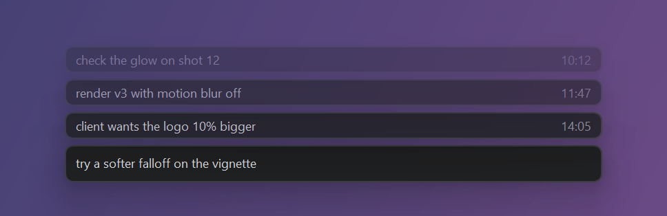

# QuickNote

**Jot down a thought without leaving what you're doing.** Press **Ctrl+Space** anywhere in Windows, type a line, press **Enter**. The note is added to today's plain-text file and the box disappears.



QuickNote is a single 60 KB exe for Windows 10 and 11. It needs no installer and no runtime, and uses about 2 MB of memory. It has no taskbar button or window of its own: it waits in the system tray until you press the shortcut.

## Features

- **Global shortcut:** works from any app. The box takes the focus right away, so you can start typing immediately.
- **Plain-text notes:** one file per day (`2026-10-26.txt`), one line per note: `[14:32:07] check the glow on shot 12`. They're readable in any editor and easy to search, sync or back up.
- **Recent notes:** your last three notes appear above the box, fading out with age. Notes from earlier days show their date.
- **Proper editing keys:** Ctrl+Backspace and Ctrl+Delete delete whole words, and Ctrl+Z / Ctrl+Y undo and redo up to 100 steps.
- **Movable and resizable:** drag the bar wherever you like and make it as big as you like. It remembers its place.
- **Subtle animations:** the box fades in, and saved notes slide up into the stack. Animations are skipped when Windows' *Animation effects* setting is off.
- **Portable:** settings live in an INI file next to the exe, so you can keep it on a USB stick or in a synced folder.

## Getting started

1. Download `QuickNote.exe` (or [build it](#building)) and put it in any folder.
2. Run it. A hint shows which shortcut to press, and an icon appears in the system tray.
3. Press **Ctrl+Space**, type, and press **Enter**.

To start QuickNote when you log in, right-click the tray icon and turn on **Start with Windows**.

## Keys

| Where | Key | What it does |
|---|---|---|
| Anywhere | **Ctrl+Space** | Open the note box (press again to close it) |
| Anywhere | **Ctrl+Shift+Space** | Open the notes folder |
| In the box | **Enter** | Save the note and close |
| In the box | **Esc**, or click elsewhere | Close without saving |
| In the box | **Ctrl+Backspace / Ctrl+Delete** | Delete the previous / next word |
| In the box | **Ctrl+Z**, **Ctrl+Y** or **Ctrl+Shift+Z** | Undo, redo |
| In the box | **Ctrl+K** | Change the two shortcuts above |

When you change a shortcut with Ctrl+K, QuickNote rejects combinations that another app already uses, that would override everyday shortcuts (Ctrl+C, Alt+F4, …), or that have no Ctrl, Alt or Win key.

## The tray icon

Right-click the tray icon to open or change the notes folder, change the shortcuts, reset the bar's size and position, toggle **Start with Windows**, or exit. Double-click it to open the notes folder.

## Moving and resizing the bar

Drag the bar by its margin (the pointer turns into a four-way arrow) to move it. It snaps to the middle of the screen. Drag its edges to resize it: a taller bar has larger text. The bar keeps its place on whichever monitor you use. If it's near the top of the screen, your recent notes appear below it instead of above.

## Settings

Settings are saved in `QuickNote.ini` next to `QuickNote.exe`, and the file is created on first run. If the exe's folder isn't writable (for example Program Files), QuickNote uses `%AppData%\QuickNote\QuickNote.ini` instead.

```ini
[QuickNote]
NotesFolder=C:\Users\you\Documents\QuickNotes
Hotkey=Ctrl+Space
FolderHotkey=Ctrl+Shift+Space
StartWithWindows=0
BarPosition=50.0,25.0
BarWidth=520
BarHeight=48
```

- `BarPosition` is the bar's centre and top edge, as percentages of the screen's usable area.
- `BarWidth` and `BarHeight` are in pixels at 100% display scaling (height 36–96).

Most of these are easier to change from the app itself. If you edit the file by hand, restart QuickNote afterwards.

## Building

Requires Visual Studio 2022 or Build Tools with "Desktop development with C++".

```
build.bat   -> build\QuickNote.exe
```

QuickNote is plain Win32 C++ in a single file, `main.cpp`. The build links the C runtime from `ucrtbase.dll`, which is part of Windows 10/11, so no Visual C++ Redistributable is needed.

## Windows security warnings

QuickNote isn't code-signed, so Windows treats a downloaded copy with caution:

- **Browser:** Chrome or Edge may say the file isn't commonly downloaded. Choose **Keep**.
- **SmartScreen:** the first time you run it, Windows may show "Windows protected your PC". Click **More info → Run anyway**.
- **Smart App Control:** on PCs where it's turned on, Windows may block QuickNote outright, and its verdict isn't predictable. A fresh build of the same source can be allowed on one build and blocked on the next. Once a particular exe has been allowed on a PC, that file keeps running there. PCs where Smart App Control is off or in evaluation mode run QuickNote normally.
